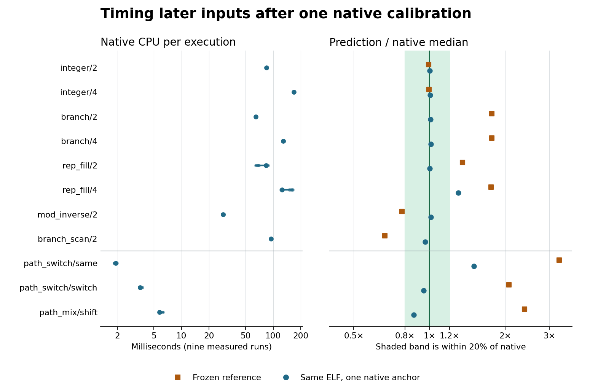

# Native CPU time from guarded work counters

On eight later inputs to five Aonohako executables, a single native run of each executable's first input brought **7 of 8 predictions within 20%** of the measured CPU median. Applying the same frozen instruction and REP weights directly gave **2 of 8**. The first native run cost 14.35–49.17 ms of CPU per real executable. In a separate test on programs excluded from coefficient fitting, adding scalar-read and far-pair counts gave **0 of 5** cases within 20%. Complete address samples gave the same outcome. [Calibration and timing results](../experiments/results/gce-guarded-native/transfer.json) · [Cross-program evaluation](../experiments/results/gce-guarded-native/evaluation.json.gz)

## Timing a later input of the same executable

Let `W(x)` be the instruction count and the total requested REP bytes, multiplied by the positive weights fitted on the earlier Aonohako C++20 reference. The model scales the measured native CPU time of the first input by `W(next) / W(first)`, rounding up once to the next nanosecond. The only new timing available to the predictor is the executable's first direct native run on the new guest. The nine later native timings per input provide the independent reference. A future input's work counters come from its actually delivered v11 report, including the full rerun where the guard rejected a sample. [Frozen weights and original corpus](https://github.com/seo-rii/aonohako/tree/b938afaa6c171a8a56e24d376d6662f93fcea4c6/docs/durante/gce-v11-cpp20-accuracy) · [Premeasurement transfer plan](../experiments/guarded_native/transfer-plan.json)

| Predictor on the same eight later real inputs | Cases within 20% | Median absolute error across cases | False timeouts / false accepts |
|---|---:|---:|---:|
| Frozen instruction and REP weights | 2/8 | 34.41% | 3 / 1 |
| First native duration alone | 0/8 | 49.71% | 0 / 7 |
| Frozen work ratio × first native duration | 7/8 | 1.03% | 0 / 0 |
| Same ratio × original guest's calibration median | 7/8 | 0.41% | 0 / 0 |

The native runs agreed on 14 of the 16 relative time-limit boundaries. The two others straddled 67 ms on `rep_fill/2` and 151 ms on `rep_fill/4`. The anchored clock agreed with all 14 unanimous outcomes. These are retrospective limits near 80% and 120% of each native median. Each job ran to completion. For each case the reported error uses its least accurate delivered observation.



The largest real miss was `rep_fill/4`. The one-shot anchor predicted 163.18 ms against the native median of 125.39 ms, an error of +30.14%. The prediction lies within the nine observed native times of 121.76–163.58 ms. The first input used 44.36 ms in its calibration run and had a subsequent median of 38.81 ms. Using the earlier guest's 32.79 ms calibration median moves the later prediction to 120.61 ms, while `rep_fill/2` then misses by −25.95%. Across the ten real cases outside the REP-fill family the two guests' medians differed by at most 1.32%. The three REP-fill medians changed by +18.35%, +31.16% and +2.89%. [Per-case measurements and historical ranges](../experiments/results/gce-guarded-native/transfer.json)

The controlled inputs illustrate the distinction between time error and coverage within an ELF. The one-shot anchor covered 2 of 3 later controls within 20%. On the larger stable path it predicted 50.42% too high, even though the prior guard had retained 99.94% of eligible reads. The disjoint path and the change of hot-site frequency use the full reports actually returned after recovery. These short controls have native medians below 20 ms. [Recovery receipts](GCE_GUARDED_SAMPLER.md#decisions-observed-on-the-guest)

## Transferring coefficients across program families

Eight inputs from `integer`, `rep_fill` and `branch_scan` train nonnegative relative least squares. All five inputs from `branch` and `mod_inverse` are held out. The two synthetic executables never train these coefficients. The following comparisons use identical case weights and targets. A case passes only if every prediction for that case lies within the inclusive tolerance.

| Model on the five real holdouts | Cases within 20% | Median absolute error | False timeouts / false accepts at 10 relative limits |
|---|---:|---:|---:|
| Instructions + REP bytes | 2/5 | 96.50% | 3 / 0 |
| Add eligible reads in the returned report | 0/5 | 77.66% | 3 / 0 |
| Also add sampled far pairs | 0/5 | 77.66% | 3 / 0 |
| Same features, trained and scored on Full reports | 0/5 | 77.65% | 3 / 0 |

The far-pair coefficient fitted to zero. At five fixed limits per input (50, 100, 250, 500 and 1,000 ms), adding reads reduced false timeouts from three to two in 25 comparisons. On `branch/4`, the read model predicted 231.78 ms compared with the native median of 128.91 ms, giving a false timeout at 155 ms. With complete samples the estimate was 231.77 ms. In the frequency-shift control, the actual full recovery captured all eight million eligible reads, but the same model predicted 27.73 ms for a native median of 5.77 ms. [Case predictions, support and limits](../experiments/results/gce-guarded-native/evaluation.json.gz)

Holding out each real family in turn gave the read-augmented model 0 of 13 cases within tolerance. On the fold excluding `rep_fill`, training contained only 3,624 REP bytes per case. A positive coefficient on that constant extrapolates poorly to a held-out input with over 8 GiB of REP work. The frozen references are research coefficients. Aonohako accepts operator-supplied policy parameters with explicit identity and positive bounded integer weights. It has no default nanoseconds-per-instruction value. [Scoring design](../experiments/guarded_native/design.json) · [Aonohako time policy](https://github.com/seo-rii/aonohako/blob/b938afaa6c171a8a56e24d376d6662f93fcea4c6/internal/durante/time_policy.go)

## Separating model error from native variation

The fastest `integer/4` execution took 167.258 ms and the slowest `branch/2` execution took 64.780 ms, a ratio of 2.58. Across the two cases the largest favorable counter ratio was 1.4633. The comparison allows any nonnegative weights on instructions, separate MOVS and STOS bytes, eligible reads, completed pairs, near pairs, far pairs and maximum reported address span, plus any nonnegative intercept. Every such sum has a ratio at most 1.4633. Even using the most favorable native timings, it must miss at least one input by **27.65%**. Both inputs met the minimum-duration and spread criteria. The same lower bound holds with full address reports. This is a cross-family witness for the specified additive clock. Per-executable calibration, nonlinear models or features outside the tested set have different constraints. [Exact rational certificates](../experiments/results/gce-guarded-native/transfer.json)

## Collection and replay

A fresh Compute Engine n2d-standard-4 guest with AMD Milan and one thread per core ran the collector and its direct children on CPU 1. The trace controller ran on CPU 0. The first seven slots are the calibration input of each of the seven executable digests. Each other case also has one warmup, followed by nine rotated rounds of all 18 inputs. Native time is child `wait4` user plus system CPU. All 180 native processes produced the expected output. CPU steal and trace loss were zero. The instance and boot disk returned HTTP 404 after deletion and the temporary SSH key was removed. [Registered schedule](../experiments/guarded_native/protocol.json) · [Native timings](../experiments/results/gce-guarded-native/dataset.json.gz) · [Cleanup](../experiments/results/gce-guarded-native/cleanup.json)

The evidence join checks ELF, stdin and stdout SHA-256 across the different guests, process/clock identities inside each archived launch and the actual recovery reports. It reuses 82 genuinely delivered observations and 95 Full observations from the guarded study. The two views share their seven first-input reports. The native rows come from a different guest than the guarded counters. Thirteen cases also have exact matches in Aonohako #154. The C++ time model already had access to some of those programs in the earlier study. The new guest provides fresh native timings on known programs. [Source verification](../experiments/guarded_native/evidence.py) · [Registration before collection](https://github.com/seo-rii/durante/commit/87e2bc4a598b0ee94201ae33884121e7f54525dc)

From the Durante checkout, Python 3.11+ can replay all published results. Pass the original Aonohako directory to verify the compact historical evidence against its source. To recreate the native guest payload, pass its `corpus/elfs.tar.xz` to `prepare.py OUT --elf-archive PATH` and run `sudo taskset -c 0 ./guest.sh` from that payload on the disposable guest.

```sh
study=experiments/guarded_native
data=experiments/results/gce-guarded-native
python3 "$study/evidence.py" --aonohako "$aonohako/docs/durante/gce-v11-cpp20-accuracy"
python3 "$study/verify.py" "$data"
python3 "$study/score.py" "$data/dataset.json.gz" --verify "$data/evaluation.json.gz"
python3 "$study/transfer.py" "$data/dataset.json.gz" --verify "$data/transfer.json"
python3 -m unittest discover -s tests -p 'test_guarded_native*.py'
```

## Calibrating another executable

The diagnostic CLI accepts an immutable, trusted, deterministic single-process static x86-64 executable. Use the standalone guarded runner to collect its first input and each later input, keeping each output directory. The calibration command replays the v11 report, launches the executable directly once on the same bytes, verifies stdout, and saves the native CPU and clock identity. Prediction reads the later run's selected v11 record and reuses the saved native time. A full recovery is tied to the final rerun's PID. The output includes exact integer nanoseconds and the implied decision at an optional whole-millisecond limit. The formula uses only live-compatible instruction and REP counts, but this CLI makes its decision from a completed report. [Guarded runner instructions](GCE_GUARDED_SAMPLER.md#using-the-diagnostic-on-a-new-executable) · [Anchor implementation](../experiments/guarded_native/anchor.py)

```sh
taskset -c "$cpu" python3 "$study/anchor.py" calibrate --elf "$elf" --stdin "$first_input" \
  --run "$first_run_dir" --out "$anchor_file"
python3 "$study/anchor.py" predict --elf "$elf" --run "$next_run_dir" \
  --policy "$anchor_file" --limit-ms 100
```

Specify a CPU available to the local worker. The policy records the inherited affinity and whether it was restricted to one CPU. The GCE study obtained its one native observation on a fresh guest. The standalone CLI takes its observation after the first guarded-run record is available. The saved anchor is scoped to the exact executable and the host used for its native reference. The project has not qualified a production grading policy from this corpus.

The [calibrated live-limit experiment](GCE_CALIBRATED_LIMITS.md) applies this policy while the next program is running and compares actual stops against complete reports and native timings on earlier and new C++ workloads.
