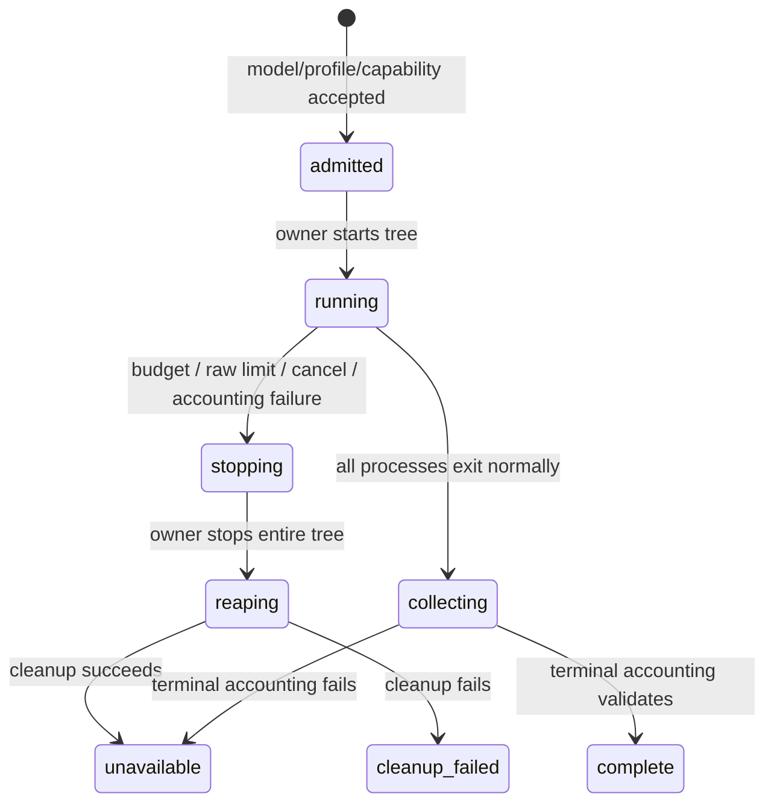

# Proposal: online work budgets

Status: **design draft; not implemented or enabled**. This specifies the remaining
work between a completed diagnostic count and stopping a running job at a work
budget. It adds no CLI option or protocol capability and does not make current
reports eligible for judge verdicts.

## Current and intended behavior

`durante run` waits for the process tree, or stops it on wall timeout/cancellation,
then collects terminal lifecycle records. These records are not a live progress
interface. Aonohako's `work_measurement_time` converts a complete eligible report
after execution. Its `nominal_time_exceeded` cannot stop an infinite loop; raw
CPU/wall/memory limits remain independently active.

The proposed feature gives the owner a work-budget stop condition alongside raw
limits. Work score and estimated native CPU time remain distinct: score has a
named unit; only a separately qualified time model can label values nanoseconds.
There is no language-specific default multiplier. Shared coefficients can apply
to several explicitly qualified execution profiles.

The first implementation should remain an opt-in diagnostic budget experiment.
Changing Aonohako's credited time or AC/TLE behavior requires a separate consumer
contract and evidence. The current diagnostic designation remains part of the
existing protocol until such a contract is implemented and qualified.

## Exact arithmetic

An operator selects a versioned model and source/runtime/engine/dispatch binding
before launch. Requests select a budget, without changing coefficients at runtime.

```text
N = instructions * instruction_weight
  + movs_requested_bytes * movs_weight
  + stos_requested_bytes * stos_weight
score = ceil(N / denominator)
exceeded = N > budget * denominator
```

All weights and the denominator are positive; equality is allowed. Use exact
wide integers and round once. Do not charge aggregate REP bytes again. Missing
operation detail is unavailable even if aggregate REP is zero. Intermediate
products can exceed uint64; overflow must never wrap into a small accepted score.

Boundary vectors for the future implementation:

| I / MOVS / STOS | Weights / denominator | Budget | Expected |
| --- | --- | ---: | --- |
| 3 / 8 / 4 | 1, 2, 5 / 1 | 39 | equal, continue |
| 3 / 8 / 4 | 1, 2, 5 / 1 | 38 | exceeded |
| 1 / 1 / 1 | 1, 1, 1 / 3 | 1 | equal, continue |
| 1 / 1 / 1 | 1, 1, 1 / 2 | 1 | exceeded |
| 9,007,199,254,740,993 / 1 / 1 | 1, 2, 5 / 1 | 9,007,199,254,741,000 | equal; no floats |

These vectors describe arithmetic, not proof of live enforcement.

## Live accounting is a separate protocol

Do not poll the existing collector on a live directory. The [schema-1 protocol](PROTOCOL.md)
requires a stopped and reaped tree. Exec checkpoints are provisional until the
exec succeeds or fails, and replay corrections can roll back BB-entry charges.
An arbitrary snapshot is therefore not a monotonic committed-work count.

A new advertised capability must identify run, process lifetime, image, thread
and update sequence, and specify:

- Cumulative or delta updates, duplicate delivery, loss and rollback handling.
- Child registration when the child runs before its parent's callback; parent
  totals must not be inherited and charged again.
- Vfork/shared-address-space behavior and exec success/failure ownership.
  Failed exec must not add both the checkpoint and later cumulative totals.
- All live threads, thread exit, final publication and parent-first exit.
- Committed versus provisional charges during internal code replay.
- Signal interruption and unsupported REP eligibility, without hiding either.

The implementation must choose between stopping after validated progress exceeds
the limit and reserving work before execution. These have different semantics:
a rejected reservation is proposed work, not executed work, and cannot become a
completed count. Pre-execution reservations also need replay reconciliation and
release of unused reservations.

Polling alone does not prove a fixed overshoot bound. Account for publication
intervals, all active threads/processes, scheduling delay and a single large REP
request. Until these rules and tests exist, do not promise exact stopping at the
limit. Raw CPU/wall/memory/task limits remain active if progress is unavailable.

## Execution and cleanup



The owner records the stop trigger and terminates/reaps the entire owned tree.
A budget event does not imply cleanup success; an exit-0 root does not imply
that descendants completed. Controller death and raw stops retain existing owner
behavior.

Preserve every observed terminal cause separately. Diagnostic presentation gives
precedence to cleanup failure, owner/accounting failure, explicit cancellation,
raw resource exhaustion and then a validated budget stop. Do not invent timing
order where it cannot be established; retain the ambiguity and deny completion.

Any forced stop leaves accepted counter totals unavailable. A separate partial
stop observation can retain model, budget, last validated progress, cause and
overshoot information. It must not reuse `measurement.complete: true` or fill
missing work with zero. The exit status and wire version for a budget stop remain
to be allocated with implementation. Consumers reject unknown requested
capabilities before target execution.

## Aonohako integration

Frontend and executor must agree on the exact budget capability, model, profile
and accepted budget before execution. A runner that ignores the option cannot
return an ordinary successful result for that request.

The profile must identify effective runtime options as well as the runtime image:
JIT/GC settings, library mode, operator defaults and heap settings derived from
raw memory limits. A request's profile name alone is insufficient. Current
Aonohako time-policy bindings match source/image/engine/dispatch; they do not
yet bind these effective options. A future live-budget admission must close that
gap rather than treating an image match as qualification of every configuration.

Keep raw CPU/RSS/wall observations, work score and optional time estimate in
separate fields. An unavailable estimate does not imply TLE. A small partial
score cannot turn an existing resource, output or execution failure into AC.
Interactive/communication budgets require role-specific stop attribution:
manager/interactor work is not contestant work. Peer aggregation/cancellation
rules are a dependency of any peer-budget rollout.

## Implementation and acceptance evidence

1. Select live-accounting semantics, capability/version, message identities,
   provisional/committed state and an attainable overshoot bound.
2. Implement client publication and owner accounting together, with lifecycle
   vectors for threads, fork, vfork, exec success/failure and replay.
3. Add bounded stop/cleanup to `run` and `isolate`, retaining raw limits and
   testing the absence of progress.
4. Add Aonohako admission, resource envelopes, local/remote reconstruction and
   role policies. Keep initial output diagnostic and opt-in.
5. Qualify intended runtime profiles and separately review any verdict mode.

Required actual-runtime cases: an infinite loop stopped by work before a generous
wall limit; equality/one-unit exceedance; large MOVS/STOS; parallel threads and
children; parent-first exit; detached descendants; exec success/failure; JIT
replay; handled signals; stale/missing progress; raw CPU/wall/memory stops;
cancellation concurrent with threshold crossing; owner/cleanup failure. Each
must show the trigger, full-tree reaping and no accepted totals after forced stop.

Measure overhead and overshoot with fixed inputs/identities, bounded campaigns
and every failure retained. A post-exit comparison, synthetic ledger or unchanged
wall-timeout test cannot replace live-stop tests. Merging this proposal supplies
none of that runtime evidence.
